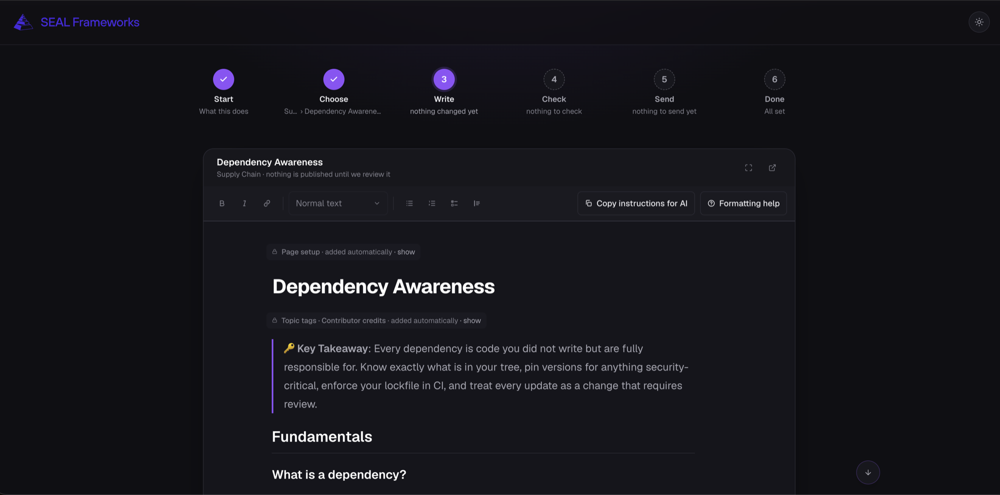

# Frameworks Contribution Wizard

A web wizard for suggesting changes to the
[SEAL Frameworks](https://frameworks.securityalliance.org) docs
([`security-alliance/frameworks`](https://github.com/security-alliance/frameworks)) without
knowing git.

Contributing to the docs used to mean forking the repo, cloning it, editing MDX files, committing
and opening a pull request. That's a lot to get through to fix one paragraph if you don't use git
every day. With the wizard, contributors pick a page, edit it like a document, read their changes
back, and send them. The wizard turns that into a pull request under their own GitHub account.
Nothing goes live automatically: maintainers review every suggestion, as they would any other.

**Live at [frameworks.securityalliance.org/wizard](https://frameworks.securityalliance.org/wizard/).**



## What contributors do

1. **Start**: a short intro with a small interactive demo and an FAQ.
2. **Choose**: pick a page, in the same order as the site's sidebar, or search for one. A
   suggestion can cover several pages.
3. **Write**: edit the page as rich text, with a formatting guide and a "Copy instructions for AI"
   button for help with the docs' style. Drafts are kept in the browser, so a reload doesn't lose
   work.
4. **Check**: the rendered page with additions and removals marked in place, plus a line-by-line
   diff.
5. **Send**: a note for the maintainers, a preview of the pull request, and the framework's steward
   asked to review it. Signing in with GitHub happens here, only when it's needed.
6. **Done**: a link to the pull request, and what happens next.

Signed-in contributors can keep track of the suggestions they've sent, and their saved drafts, from
their profile menu.

Coming soon: creating new pages, with new frameworks following after that.

## How sending works

Contributors send from their own copy of the docs (a fork), the same way anyone outside the
project does. The first time, the Send step walks them through two one-time steps on GitHub's own
pages: making the copy with the Fork button, and allowing the wizard to use that copy only. After
that, pressing Send:

1. Saves their changes in a new branch of their copy, as one commit under their name. GitHub signs
   the commit itself, so it shows as Verified.
2. Opens a pull request to the Frameworks docs, using the repo's usual pull request template.
3. Asks the framework's steward, if it has one, to review. People credited on the pages are named
   but not tagged, so nobody gets a notification about a typo.

If the docs changed while the contributor was writing, GitHub combines the two when the suggestion
is merged. If someone changed the same lines, the pull request says so, and maintainers sort it
out. Contributors only need to step in when their copy is too far behind for the change to apply:
then the wizard asks them to click **Sync fork** on GitHub to bring it up to date.

## What the wizard can access

- **Only the repositories its GitHub App is installed on:** the contributor's fork, which they pick
  when installing it, and `security-alliance/frameworks`, so it can open the pull request there.
  Nothing else on their account.
- **Only two permissions:** the files in those repositories, and their pull requests. No access to
  workflows, no account permissions, no webhooks.
- **It acts as the contributor, within those limits.** Every call uses the signed-in contributor's
  own token, so everything it does shows up under their name. The app's private key is never used.
- **Commits only go to a new branch in the fork.** On the Frameworks repo, the wizard only opens
  pull requests.
- **Sign-in expires after 8 hours.** The GitHub token is kept in an encrypted, HTTP-only cookie: the
  page's code can't read it, and only the wizard's server can decrypt it.

You don't have to take our word for it: all of this is in [`functions/`](functions/).

## Contributing

Requires Node 24 (see `.nvmrc`) and pnpm 10.

```bash
pnpm install
pnpm dev        # Vite dev server
pnpm typecheck  # frontend and functions
pnpm build      # typecheck + production build into dist/
```

`pnpm dev` runs the frontend only. Pages are read straight from GitHub's public endpoints, so
everything except signing in and sending works locally. Those need the Worker in `functions/` and
its secrets.

`src/components/site/` holds copies of components from the frameworks repo, so the preview matches
the live site. If they change upstream, update the copies here too.

Found a bug, or have an idea for a feature? [Open an issue](https://github.com/security-alliance/frameworks-wizard/issues).
Want to fix or build it yourself? Branch from `main`, make sure `pnpm typecheck` passes, and open a
pull request.
